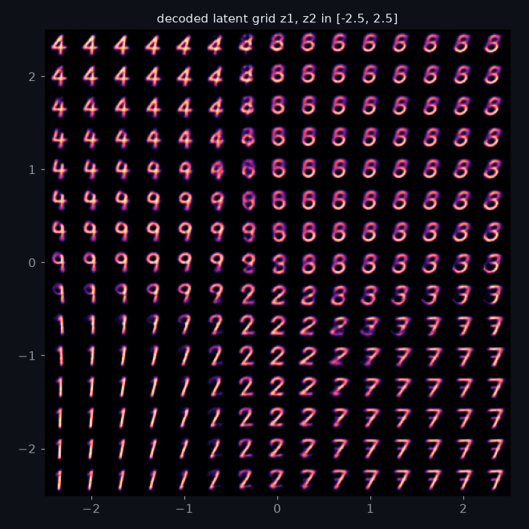
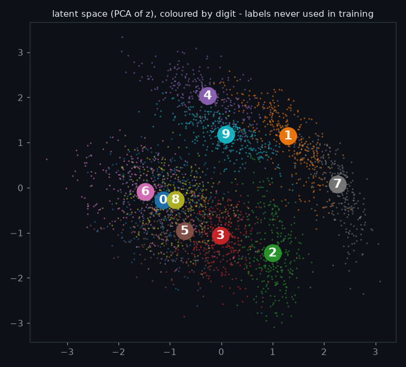
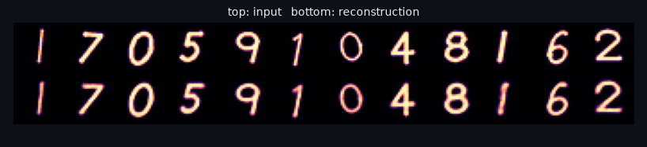
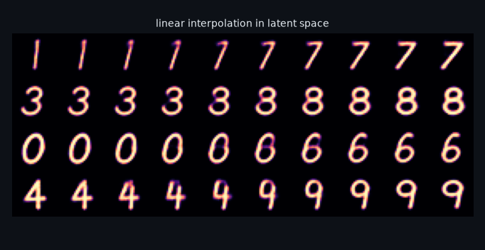
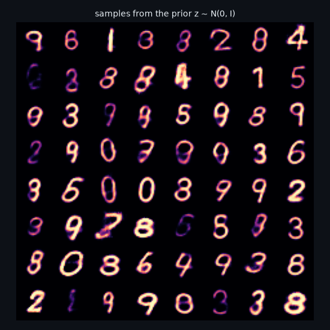
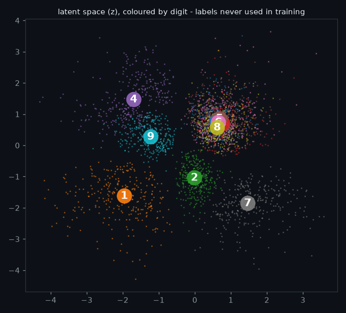
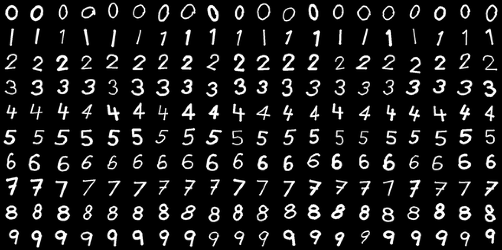

# glyph-vae

[](https://github.com/hbtabi/glyph-vae/actions/workflows/ci.yml)


A **convolutional variational autoencoder written from scratch in PyTorch**, trained on a
**procedurally generated digit dataset** (no downloads, no MNIST), with tools to explore what the latent
space has learned. Each model trains in about a minute on a laptop CPU.

<p align="center">
  
  
</p>

*Left: decoding a grid of points from the 2-D model's latent space. Right: test digits encoded by the 8-D
model, projected with PCA and coloured by label. The VAE never sees the labels.*

## Features

- **Synthetic dataset, built in** (`glyphvae/glyphs.py`): every digit is a set of stroke templates
  (lines and elliptical arcs). Each sample gets random slant, rotation, scale, aspect, offset, wobble and pen
  width, and is rendered with 4x supersampling down to 28x28. You get unlimited fresh samples and there are no licence questions.
- **ConvVAE** (`glyphvae/model.py`): conv encoder → (μ, log σ²) → reparameterisation → transposed-conv
  decoder with a **Bernoulli likelihood**. The loss is the exact negative ELBO in nats (BCE + analytic KL).
- **Training that behaves**: KL warm-up (to avoid posterior collapse), β-VAE option, OneCycle LR,
  gradient clipping, fp16 checkpoints (~0.9 MB each).
- **Honest metrics**: test-set −ELBO, reconstruction and KL terms, and a **latent kNN probe**: how
  well digit labels can be predicted from μ(x). This measures whether the unsupervised latent groups
  digits by class.
- **Visualisations**: latent scatter (raw for 2-D, PCA otherwise), decoded manifold, reconstructions,
  latent interpolations, samples from the prior.
- **CLI**: `glyph-vae preview | train | eval | plot`.

## Results (bundled checkpoints, 12 epochs, 30k training digits, CPU)

| checkpoint | latent dim | test −ELBO (nats) ↓ | recon | KL | latent kNN acc ↑ |
|---|---|---|---|---|---|
| `checkpoints/vae_z8.pt` (default) | 8 | **80.1** | 63.4 | 16.7 | **0.989** |
| `checkpoints/vae_z2.pt` | 2 | 122.1 | 114.7 | 7.4 | 0.59 |

kNN probe: 5-NN on μ(x), using 5,000 labelled training digits and 3,000 test digits. Chance is 0.10.

The 2-D model exists so the latent space can be **plotted and walked directly**. The squeeze costs a
lot, though: digits with similar loops (0, 3, 5, 6, 8) end up in one overlapping region, and some classes
(0 and 5) hardly show up in the decoded grid. Eight dimensions separate the classes almost perfectly.
Run `glyph-vae plot` to see both:

| | |
|---|---|
|  |  |
|  |  |

Training data preview (`glyph-vae preview`):



## Quick start

```bash
git clone https://github.com/hbtabi/glyph-vae && cd glyph-vae
python -m venv .venv && source .venv/bin/activate
pip install torch --index-url https://download.pytorch.org/whl/cpu   # optional: small CPU-only wheel
pip install -e ".[dev]"

glyph-vae eval                                   # metrics for the bundled 8-D model
glyph-vae plot --out-dir figs                    # all figures (+ 2-D manifold from vae_z2.pt)
glyph-vae train --latent-dim 16 --epochs 12 --out runs/z16.pt   # ~1 min on CPU
glyph-vae train --latent-dim 2 --beta 4 --out runs/beta4.pt     # beta-VAE: smoother, blurrier
glyph-vae eval --ckpt runs/z16.pt
pytest -q
```

Everything runs offline. No API keys and no network access are needed after installing.

## Project structure

```
glyphvae/
  glyphs.py   procedural stroke-based digit generator (28x28, anti-aliased)
  model.py    ConvVAE + negative-ELBO loss (Bernoulli decoder, analytic KL)
  train.py    training loop, KL warm-up, OneCycle, evaluation, kNN probe, fp16 checkpoints
  viz.py      latent scatter / manifold / reconstructions / interpolation / prior samples
  cli.py      preview | train | eval | plot
checkpoints/  vae_z8.pt (default), vae_z2.pt (for the 2-D manifold)
docs/         figures used in this README
tests/        data, model maths (KL, reparameterisation grads), training round-trip, CLI
```

## How it works (short version)

For an image x, the encoder outputs μ(x) and log σ²(x). We sample z = μ + σ·ε with ε ~ N(0, I), which
keeps the sampling step differentiable (the reparameterisation trick). The decoder maps z to per-pixel
logits. Training minimises

```
-ELBO = E_q[-log p(x|z)]  +  β · KL(q(z|x) || N(0, I))
         (binary cross-entropy)   (closed form: -½ Σ (1 + log σ² - μ² - σ²))
```

β is ramped from 0 over the first epochs (KL warm-up), so the decoder learns to use z before the prior
pulls the posteriors together.

## Roadmap

- [ ] Importance-weighted bound (IWAE) to report a tighter log-likelihood estimate
- [ ] Conditional VAE (digit label as input) for controllable generation
- [ ] VQ-VAE variant with a discrete codebook
- [ ] Letters and symbols in the glyph generator
- [ ] Small web demo: drag a point around the 2-D latent and watch the decoded digit

## Limitations

- The data is **synthetic and much easier than real handwriting**. All styles come from a handful of stroke
  templates, so these numbers cannot be compared with MNIST results.
- Bernoulli likelihood on grey-level pixels is the standard choice but not a perfect fit. It makes the
  −ELBO an approximate measure.
- As in most small VAEs, reconstructions and samples are somewhat **blurry**, and a few prior samples are
  ambiguous (between 3/8 or 4/9).
- The 2-D model's latent space has heavy class overlap (see above). It is there for visualisation, not as
  a good model.
- The kNN probe uses labels at evaluation time only. It is a diagnostic, not a classifier benchmark.

## License

[MIT](LICENSE) © 2026 Mohammed Hassan bin Tayyeb
